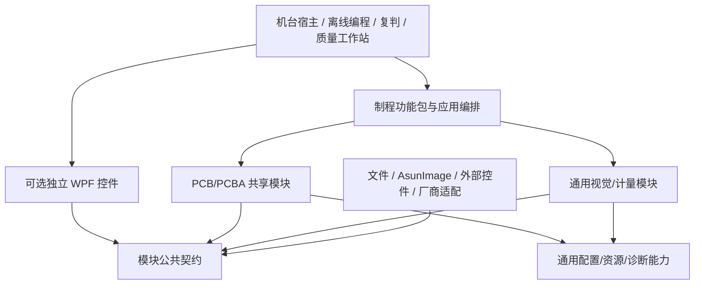

# 全制程平台设计基线

- 文档 ID：`PLATFORM-DESIGN-001`
- 版本：`0.4.0`；日期：2026-09-27
- 状态：`DesignReview`。本轮落实用户确认的平台化与文档分层方向；工程方案可供评审，未将整个平台标为 ImplementationReady/Implemented。项目 AsunImage 的 HALCON 基线为 26.05。
- 消费者：平台/产品架构负责人、模块与制程开发人员、UI/算法/测试/集成人。
- 唯一导航：[PROJECT_ENTRY](../../PROJECT_ENTRY.md)；历史架构来源：[ARCH-PCBA-VISION-001](ARCH-PCBA-VISION-001_v0.5.3_source.md)。

## 1. 本轮设计范围与文件职责

平台承接 PCB 与 PCBA 的全制程视觉检测，不等于将全部制程塞进一个机台应用。当前交付为设计基线：制程/机台覆盖、公共模块、各制程专项、功能链路、来源与待决事项。它不启动旧代码队列，不迁移已有控件，不实施 SDK。

公共模块与制程专用指导分别存放在 `docs/shared-modules/` 和 `docs/process-guides/`。原有 DEV/FS/Page 文档移动到相应根下的 guidance，ID 和内容来源保留；旧目录仅留位置索引。新增模块/制程指导补齐组合与功能链语义；已有 FS 继续负责已定义的细节，不复制字段/状态。

| 文件 | 唯一职责 |
|---|---|
| 本文 | 平台边界、分层、组合、部署与全局不变量 |
| shared-modules/README + modules/SM-* | 公共模块总目录、依赖、单模块语义与独立交付要求 |
| process-guides/README + processes/PG-* | 制程/机台矩阵、专用检测功能、产品操作链、验收场景 |
| shared-modules/INTERFACE-MAP.md | 生产者/消费者和权威绑定索引，仅引用，不重定义 DTO |
| process-guides/END-TO-END-FLOWS.md | 编程、生产、复判重检、离线、恢复、跨工序链路 |
| GATE-001 | 旧权威来源接纳方式、缺口和影响范围 |
| DEV-PLAN-000 | 原 ID 到当前位置的导航 |

机台层已有 2D/3D 分类文档是设备能力参考；制程层才定义炉前、炉后、印刷、钻孔、阻焊等业务差异。两者不能以目录名一一等同。X-Ray/CT、ICT、FCT 只保留入口；现有蚀刻后光板项目等待用户交付，不重新设计内部算法。

## 2. 固定前提与设计决定

用户已确定：VS2026、C#/.NET10、WPF、DevExpress25.2.3、AsunImage；通过 ImageLibDotNet 公共边界使用，项目内 AsunImage 对应 HALCON 26.05。算子核对入口为 [`halcon算子手册/operators`](../../halcon算子手册/operators/)，实际适配仍须以已安装 ImageLibDotNet 公共签名为准。AsunImage/DevExpress 不验证、不检查授权。软件自身结果/UI/性能仍按指导验收。

本轮工程方案：模块化单机装配是基础交付方式；独立复判、离线编程与质量工作站消费明确接口，可单独部署。业务能力 DLL 不强制转成微服务，平台不要求每台机器连接中心服务才能计算。具体离线缓存、数据保存与生产许可由产品配置确定；未决定的数据一致性策略不能默认允许离线生产。

公共模块分通用软件/视觉能力和 PCB/PCBA 共享能力两类；后者可理解板、拼板、程序和检测事实，但不能写死 SPI 或 AOI 判定。特有对象、参考定义、缺陷判定和操作页留在制程包。

## 3. 架构与依赖

图表示编译依赖与适配责任；设备数据可以反向流入消费方，但不允许 UI、领域或算法反向依赖厂商实现。宿主组合根装配实现，公共模块不得自行定位某机台的全局容器或私有数据库。

独立模块是一项完整职责的能力包。必要时内含 Contracts/Core/Wpf/Adapters 多个 DLL，但不机械要求每模块拆同样数量。无 UI 的能力须能被无界面宿主测试；UI 控件可在最小宿主独立显示，语言由宿主调用。程序集/进程/逻辑模块是三个不同边界。

每项共享能力至少列出两个当前规划消费者或清楚的复用计划、版本兼容策略和独立验证断言。共享不是把每种产品对象塞进万能 DTO；新增跨制程需求由相同语义判断是否共享，不按字段外形判断。

## 4. 既有独立资产

| 资产 | 平台接入原则 | 禁止事项 |
|---|---|---|
| Asun_ROI | 复用其公共工作台与无界面 Session；ROI、几何测量、结果/Overlay 能力通过适配接入 | 平台再建一套同职责 ROI/量测控件；直接依赖其内部 Store；自动迁移 .NET8 |
| Asun_DeepSight | 经设备端口及数据适配接入，设备调试 UI 可独立嵌入 | ROI 与激光控件互引；把设备控件变成板级判定者；本轮改 SDK |
| Gerber/ODB++/IPC-2581 外部项目 | 提供导入结果与 HALCON Region/XLD 元素；平台管理来源快照、单位/坐标/层/元素映射和生命周期接入 | 重新实现解析器；在未拿到接口时假定对象所有权和文件格式 |
| PCBA AOI | 当前源码与指导作为复用来源，按具体公共能力和制程语义接纳 | 全量复制产品规则、静态状态、线程/工作树/客户授权或运行事实 |

## 5. 数据、状态与副作用边界

数据分四类：输入及参考快照、计算/量测输出、已提交检测事实、显示/报表/AI 投影。每类标明创建者、拥有者、版本、作用域、有效性及资源释放者。图像/高度场用显式租约或不可变数据边界；制造数据适配层处理 Region/XLD 对象生命周期，不把原生句柄泄漏给 UI 或领域。

规则计算、机台运行状态、人工复判、结果持久化和最终物理动作分别负责。规则引擎可复用，规则内容属于制程；质量服务消费已提交事实，不重算并覆盖原机判。运行/保存/质量状态不压成一个枚举。精确状态词表沿用批准契约或作为明确候选审阅，不把旧 AOI 专属 Owner 改名后宣称已冻结。

ACK、执行完成、状态回读、结果提交、物理板离开是不同事实。结果保存不明时查询相同提交身份，不能重算生成另一条生产事实来掩盖失败。重检产生新的检测尝试并关联原尝试，不修改历史。UI 取消不撤销已提交事实或已经发生的设备动作。

## 6. 必须分开的运行链

- 编程：制造资料/样图 → 目标/ROI → 算法与参数 → 离线/试板验证 → 程序版本 → 产品允许的发布。
- 生产：识别与程序解析 → 就绪/防错 → 采集 → 分析与量测 → 规则评价 → 结果提交 → 产品处置 → 设备确认。
- 复判/返修：已提交结果 → 领取与证据查看 → 人工结论 → 返修记录 → 新尝试复检 → 经授权处置。
- 回放：保存输入与冻结版本 → 离线重算/对比 → 工程结论。回放不是每块生产板放行前的必经动作。
- 服务恢复：故障识别 → 停止受影响接收 → 确认资源/物理位置/提交状态 → 用户可理解的恢复 → 继续或结束。
- 跨制程：关联精确对象/制程/尝试 → 读取已提交事实 → 覆盖与迟到/缺失检查 → 统计或授权处置；不能从某工位通过推定全流程通过。

## 7. 非功能要求的制定方式

性能先写负载模型，再写预算：板/拼板/卷段规模、FOV/目标数、图像/高度数据量、并发轨道与运行模式；分开采集、计算、落盘、界面和网络。总预算包含资源竞争，不能将各模块单测时间直接相加当节拍。生产完整数据不能静默丢弃；预览允许 latest-wins，但不改变生产队列。

本轮先明确测量点、负载维度和预算拥有者；具体节拍、板尺寸、误差/重复性及容量由产品输入确定，不填猜测数字。实现者可以提出队列、缓存、取消等工程策略；客户阈值和设备极限必须有来源。

部署/升级按产品装配锁定依赖版本，支持配置迁移、失败回退和旧事实读取。独立 DLL 不等于不可信代码安全隔离；需要隔离的插件/本机资源按受影响产品决定进程边界。详细策略见模块指导，不默认热卸载运行中的视觉资源。

## 8. 设计接受与实施准入

本轮设计接受检查：每个活动制程有功能和场景；每个公共模块有真实规划消费者、唯一职责、依赖和独立验收；每条关键交接有输入输出、状态/错误/资源与后续行为；没有共享模块依赖制程私有类型；所有待决项明确影响范围。

能进入实施的切片还须有批准的公共接口/Schema、状态/Owner、参数策略、页面命令、测试样例和适用的预算。文档全面不代表这些条件已经满足；条目不得因套用模板而变为 ImplementationReady。

## 9. 本轮方案选择及来源

采用模块独立交付与宿主组合、公共技术能力和工艺语义分离、离线与生产共用计算边界、输入/结果/处置权威分离。依据包括原架构的分层、现有两个控件公共文档、REF-002 本轮固定源码研究，以及 REF-006 的竞品实际操作证据。没有引入开源库、设备协议或第二事实库。

开放问题集中在 GATE-001：原权威资产的接纳/修订、外部 CAM 接口、具体机型/采集形态、质量/参数与性能目标。它们不阻止当前文档设计，却约束相应实现或现场验收。下一阶段按模块/制程逐项冻结，不恢复旧 69 项全量自动开发队列。

本轮研究可直接追溯至[REF-002固定源码与官方资料](../references/REF-002_GitHub_DevExpress与OpenSource研究基线.md)和[REF-006竞品页码映射](../references/REF-006_制程与公共模块的竞品证据映射.md)。细化现有ID的定位见[文档地图](../09-development-plan/DEV-PLAN-000_开发指导文档地图.md)，当前待决事项见[OPEN-GATES](OPEN-GATES.md)。

## 10. 交付项目迁入平台的路线

用户已确定现有项目成功交付客户后统一迁入平台，过程中允许修改完善。当前不安排交付中项目的重构或技术迁移，也不以平台文档发布触发其它项目自动更新。

| 阶段 | 需要保留或形成的产物 | 通过条件 |
|---|---|---|
| 客户交付基线 | 实际交付版本、配置/配方/数据、验收范围、已知限制和部署清单 | 以用户确认的成功交付为迁移起点，不从仓库状态猜测 |
| 能力与差异盘点 | 已实现功能→SM/PG映射；公共接口、数据/单位/坐标/Owner、UI、依赖和许可证适用要求 | 区分直接复用、适配、提取与需要完善；不扫描AsunImage内部，不重新核验其或DevExpress依赖/授权 |
| 单一权威接入 | 平台正式契约与旧语义差异、兼容适配、数据/配置迁移与回读办法 | 不同时维护两套生产Owner；旧数据可解释，不覆盖客户历史事实 |
| 平台独立验证 | 无界面/最小宿主、原客户Golden回归、新工序反例、迁移失败恢复 | 旧项目验收可作为来源，不能替代改变边界后的集成/回归证据 |
| 受控汇入与维护 | 平台模块版本、产品装配、发布/回退和客户维护分支关系 | 用户确定上线窗口；可恢复原交付版本；有副作用的历史操作不重放 |

既有AOI、ROI、DeepSight和CAM分别保留自身职责；已完成光板线路项目等待交付资产后按同一路线盘点。具体拆分数量服从真实复用和契约稳定性。客户侧维护与平台演进的修复合并方式逐项批准，不承诺自动双向合并。

## 11. 未开发机台研究的架构落实

[REF-007](../references/REF-007_未开发机台竞品研究与设计落点.md)和[REF-002](../references/REF-002_GitHub_DevExpress与OpenSource研究基线.md)将官方资料与固定commit源码落实到19项未开发/相邻制程指导及16项公共模块细则。研究顺序已获用户确认；主链、物理量/覆盖/参考模式的交接进一步见PLATFORM-INTERFACE-001 §6与PLATFORM-FLOW-001 §8。

共用的是帧/坐标/标定、几何/区域/表面、覆盖、执行、比较、证据和显示等能力；工艺包持有对象解释、参考目的、被测量和判据。单表面高度、膜厚、区域覆盖、检测完整性不得因名称相似而合并。质量处置Owner继续按正式权威绑定，统计模块只作投影。新增方案没有引入开源运行时、硬件SDK实现或第二套Schema。

## 12. 四项平台要求与工程补充（2026-09-27）

1. 所有功能设计先检查HALCON能力；适用时优先经AsunImage和既有控件复用。替代算法必须在该功能指导登记实际能力缺口与比较证据。业务权限、事务和工艺解释保留在原层。
2. 精美的DevExpress界面、高阶联动与流畅操作是产品交付要求。DEV-UI-040冻结统一设计方法；26份PageContract补充本页构图/连续任务/恢复/拟验收。视觉和真实WPF行为分别验收，候选视觉数值不充当已验证设备指标。
3. 已确认复用能力必须独立交付。28份SM分别明确核心库、可选控件、宿主适配、逐操作调用和两个消费者场景；制程页面及判据留在工艺包。公开契约、无界面核心与可选WPF包装遵守依赖方向。
4. 23份PG的当前72项功能逐一链接专项实施卡，给出HALCON路线、输入、处理顺序、输出/模块分工、失败恢复、页面操作及具体拟验收示例。复合项分别定义结果；不能把“有一份机台概述”当逐功能可编码。唯一覆盖导航是[DEV-PLAN-000](../09-development-plan/DEV-PLAN-000_开发指导文档地图.md#功能覆盖与实施深度)。

补充的共同要求：输入/参数/算法/标定可追溯；离线调试与生产复用计算；质量未知可见；资源有界且取消可恢复；单一事实权威；版本升级保留客户配置/历史和回退路径。指导以DEV-GOV-010十二项作为普通程序员可实施标准。当前细化完成不代表正式Schema/Owner/API、客户阈值、设备可观测性、样本和页面Profile已冻结，逐项准入仍执行，不能承诺文档已完美或全平台均可直接开工。

## 13. 全量代码开发准备与并行落地

开发策略和阶段见[DEV-PLAN-001](../09-development-plan/DEV-PLAN-001_研发实施步骤与并行开发计划.md)，任务依赖唯一维护于[DEV-PLAN-014](../09-development-plan/DEV-PLAN-014_全量研发工作包与并行依赖DAG.md)。采用最小公共能力、完整工程链、第二制程及不同数据模态验证复用，再扩大独立模块/制程并行的候选路线；不把SPI固定为首台，不将原69FS当平台全集。

多会话遵循[DEV-PLAN-002](../09-development-plan/DEV-PLAN-002_功能与模块并行度矩阵.md)的唯一文件Owner、冻结契约、独立工作树和串行接收。程序集/目录仅是DEV-PLAN-006规划候选，实施前与FS真实落点统一；不能据规划创建第二套契约或绕过现有模块。当前持续Goal负责准备，尚未批准全量产品实现。

## 14. 独立交付模块与AOI资料接纳

用户19条是思路来源，28SM是原责任分组，均不作为独立模块个数。当前[独立模块架构审查](../independent-modules/INDEPENDENT-MODULE-ARCHITECTURE.md)筛选52项候选；[MODULE-CATALOG](../shared-modules/MODULE-CATALOG.md)中的62个PKG和6类工具宿主仅作历史迁移映射，各PG保留工艺组合。PKG继承既有事实/契约Owner，不因拆包增加同义数据权威；正式项目依赖/签名按唯一契约采纳。

PCBA AOI原文/代码只读，完整指导及相关契约通过[REF-008](../references/REF-008_PCBA-AOI指导副本与平台采纳映射.md)保存原字节并映射平台落点。平台只在自己的指导修订；源成熟度、硬件/性能阈值、授权、模型设置、工作树或运行队列不继承。全量文档继续多视角复核，模块数量和复制完成均不代表实施准备完成。
