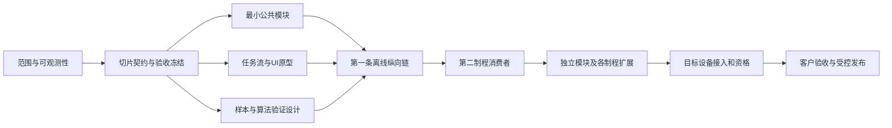

# 研发实施步骤与并行开发计划

- 文档 ID：`DEV-PLAN-001`
- 版本：`2.1.0-prep`；日期：2026-09-27；状态：`DesignReview`
- 当前依据：[平台设计基线](../00-baseline/PLATFORM-DESIGN-BASELINE.md)、[功能地图](DEV-PLAN-000_开发指导文档地图.md)、[未决条件](../00-baseline/OPEN-GATES.md)。
- 本次为全量代码开发准备。计划不授予生产写权，不表示尚缺的契约、API、样本或客户指标已冻结。

## 1. 目标与完成口径

交付对象是随后由普通开发者和多个AI会话执行的开发基线，包含完整职责、功能变体、接口、数据/状态、UI、算法、资源预算、部署恢复和验收。用户要求尽量一次开发完成，工程上落实为在编码前关闭可决定的歧义、用纵向链尽早验证高风险边界、用消费者验证独立模块；不能承诺不存在后续缺陷或修改。

69份FS、72个现有功能分组、26份PageContract只是已有覆盖，均不作为全平台上限。功能唯一落点仍在SM/PG及其所链接指导；本文件不重写功能规格。X-Ray/CT、ICT、FCT只入口，蚀刻后光板线路内部等待资产；现有客户项目交付成功后才进入迁移。

## 2. 开发策略与关键路径

先完成必要基础，再用一个有完整失败恢复的离线制程闭环检验模块边界，随后用不同制程验证复用，最后沿依赖扩大开发。基础、算法、界面不是三次独立交付：一个能力须有真正消费者和对应操作链。

此图仅表达阶段，工作包前置唯一维护在DEV-PLAN-014。建议第一条工程链选PG-002钻孔离线样本，第二消费者选PG-013钢网开口，增加非圆形/区域/位置语义验证；这是减少风险的**工程试验顺序候选**，不是首台投产产品决定。3D资源与参考面另用PG-003或PG-014离线高度输入补充，不能用两项2D验证替代3D架构验证。旧“SPI必须先开发”不再作为调度前提。

## 3. 从准备到交付的阶段

| 阶段 | 具体工作与可并行部分 | 退出凭据与下一步 |
|---|---|---|
| D0 范围分解 | 每PG按材料/几何、2D/3D、单/双面、离线/在线、资料来源、角色、异常/恢复展开；共用能力链接SM；研究顺序按用户决定 | 每个要求有唯一实施落点；不支持/条件支持明确；不能仅有一级功能名 |
| D1 研究和任务设计 | 官方算子/公共接口、竞品操作链、开源源码测试、完整输入输出样例、UI原型、性能模型、快速编程和AI适用性同时设计 | 十二项实施内容可走查；未知被限定到具体依赖；候选决定集中提交，不让编码者临时决定 |
| D2 切片冻结 | 先冻结首条链及第二消费者共同需要的最小接口/状态/资源语义，冻结PageContract与验收向量；不一次宣布所有契约冻结 | 该切片有可定位唯一Contract、Owner、版本、参数来源、代码位置、测试输入；产品决定按GATE-001采纳 |
| I0 工程骨架 | 组合根、配置、诊断、语言/权限最小服务，独立模块引用与契约测试、可重复构建；边界稳定者并行 | 两个空宿主可接入目标模块；错误/取消/退出可观察；未开始厂商SDK |
| I1 第一纵向链 | 输入与身份→冻结程序/标定→目标→算法→评价/完整性→提交与查询→WPF操作→回放；同时完善性能测点 | DEV-PLAN-015完整场景通过；明确工程与生产用途；事实未获批时仅工程运行 |
| I2 复用与3D验证 | 第二制程引用相同核心；追加高度/无效域/大数据生命周期验证；用差异修订接口后再放开消费者 | 不复制SM、不依赖第一机台页面/私表；公开接口能表达差异；共同回归无回退 |
| I3 扩展 | 按DAG逐模块/制程开工；功能包内算法、应用、UI和验证形成闭环；存储恢复/集成/部署同步 | 每个产品的正常/换线/恢复/维护链完成，不用模块数量代替整机完成 |
| Q 资格与客户迁入 | 具体设备、Golden、计量、长稳、真实WPF、FAT/SAT与发布；迁入项目先固定客户交付基线 | 相应Profile实际通过，保留旧交付/配置/历史数据与回退；不以模拟冒充设备验收 |

AI样本设计、标签定义、数据隔离、模型候选从D1开始；推理需依赖稳定输入/资源契约。快速编程先支持确定性的资料解析、库匹配、差异传播和验证，学习算法作为候选能力加入，不能把所有快速编程等到AI最后一阶段。

## 4. 制程推进顺序与扩展边界

研究/细设优先级：PG-002/003 → PG-006/011 → PG-013 → PG-016/021 → PG-019/020；其余PG按共享依赖和工序链补齐。研究顺序不强制所有后续编码串行，也不改变首台生产设备、交期和传感配置尚未决定的事实。

PG-001/004/005/007/008/009/010/012补足PCB相邻工序；PG-015/017/018/022/023补足PCBA输入、装配、焊后、终装和复判返修。PG-014与现有AOI能力以平台接口准备和交付后迁入为主，不侵入正在交付的工程。R2R必须单独验证连续位置、区段边界和不可停料条件，不能复制停板流程。

## 5. 每个层面的开发准备交付

| 层面 | 准备产物的唯一位置 | 何时不准开工 |
|---|---|---|
| 架构/复用 | PLATFORM-DESIGN-001、各SM、INTERFACE-MAP | 责任/消费者/资源/状态权威仍互相矛盾 |
| 功能/工艺 | 各PG功能卡及唯一FS；DEV-PLAN-000导航 | 开发者需要猜被测量、方法、参数、适用材料或失败结论 |
| 接口/状态 | GATE-001采纳的正式契约；C候选仅用于评审 | 字段、可空/单位、幂等、Owner、兼容、线程/取消未定 |
| UI/操作 | PageContract、DEV-UI-040～046、可评审原型 | 只有截图，没有命令/权限/异常/批量修改/撤销与恢复行为 |
| 性能/鲁棒 | DEV-PLT-014、各能力Profile与干扰样本计划 | 仅写“高性能”，没有负载、关键路径、内存/队列上限与拒识策略 |
| AI/快速编程 | DEV-AI-060～063与逐PG专属生成/审核逻辑 | 只有模型名，没有输入证据、拒识、复算、数据泄漏/回退设计 |
| 多会话实施 | DEV-PLAN-002/003/014/015 | 同一写入入口被双领，依赖只是计划完成或消费者依赖未提交分支 |
| 交付/迁移 | SM-028、产品迁移/部署切片 | 数据不可恢复、无法区分软件回退和数据库回退、旧客户配置无人负责 |

## 6. 对标与返工控制

对标按相同工件/缺陷、模态/分辨率、标准版本、统计分母、操作员熟练度及节拍口径比较。产品页仅证明公开宣称；手册能证明操作设计；同条件样本、计量与现场测量才证明结果。每项比较保留来源、未知和本平台验收方法，不写无证据的“国际领先”。

高返工风险优先顺序：身份/坐标/资源与事实权威 → 采集能力和可观测性 → 程序变化传播 → 异常恢复/重试 → 操作链 → 算法与性能 → 跨工序/部署迁移。性能方案和视觉稿可以早期并行，不能替代上游语义冻结。以一次纵向集成暴露问题后再放大并发，禁止最后一次性拼接全部模块。

## 7. 本轮状态

本计划是当前可执行方向的设计稿。DEV-PLAN-014定义调度粒度，DEV-PLAN-002定义并行写入边界，DEV-PLAN-003定义任务输入，DEV-PLAN-015定义首条链验收。没有创建或调度产品实现会话，没有恢复旧队列。全量详细设计Goal继续推进；计划修订不是Goal完成。

## 8. 本轮补充的实际执行计划

1. 已建立AOI原文副本与91份逐份落点，见REF-008；原交付项目只读。先核来源完整，再逐功能R1–R4复核，复制不提升成熟度。
2. 已重新推导60个独立公共能力包及6类工具宿主，见公共MODULE-CATALOG；逐包完善全部功能变体/接口/参数/UI/失败链，19条需求和28SM均不是数量上限。
3. 坐标/帧/标定/有效域先消歧；并行准备2D/3D方法、数据挑战集与页面任务。每个包的细化指导列出直接能力前置，契约Owner逐链串行采纳精确类型/样例。
4. 优先闭合离线检测→完整性→规则→证据/回执→复判/历史解释，校验2D与3D两条输入路径；任一必要项Unknown不能被聚合隐藏。
5. 配方/库/快速编程贯穿“导入→草稿→试检→差异→发布”，涵盖人工修改保留、版本切换与回退；随后并入设备接口/模拟，真实SDK按用户既定范围后续处理。
6. 逐产品补全专用逻辑和全部页面、AI方案、性能/长稳、数据迁移/部署。每轮同时核上下游消费者，不等写完全部文档后才集中集成。
7. 只有Ready任务才按DEV-PLAN-002§8滚动创建/复用独立研发会话；包Owner完整交付，主任务串行接收，再扩大并发。准备、实现验证和生产资格分别统计。

上述是依赖顺序，不是虚构工期；精确用时要在第一纵向链获得实际研发/返修/接收吞吐后估计。不承诺用文档消灭全部后续返工，而是编码前关闭可决定歧义、把无法确定的条件限制在对应切片。
