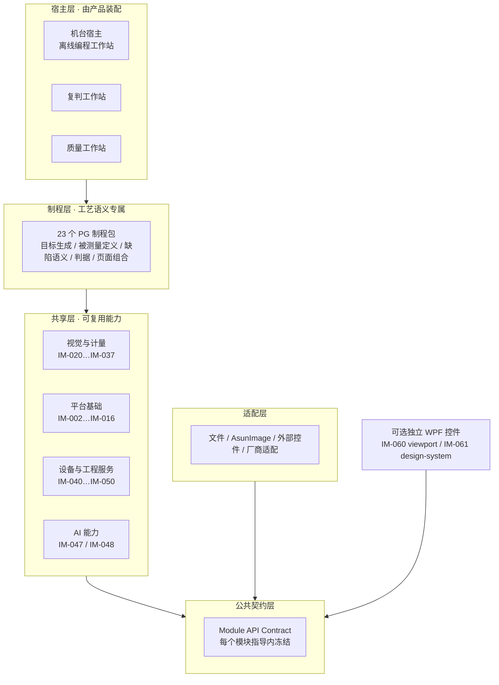

# PCB / PCBA 全制程检测平台 — 架构与简介

> 本页是**平台全景总览**：一站式回答"这是什么、怎么分层、有哪些能力、数据怎么流、怎么开始读"。
> 它是**导航与摘要**，不是新权威。任何可实施语义、契约、参数与验收标准仍以各自的唯一权威文件为准（见[文档体系总入口](DOCUMENTATION-ENTRY.md)）。

- 文档 ID：`PLATFORM-ARCH-001`
- 版本：`0.1.0`；日期：2026-10-29
- 状态：`DesignReview` — 架构快照，非实施准入
- 消费者：新加入的架构师、算法工程师、UI 工程师、测试与集成人员、评审方

---

## 0. 一分钟读懂

| 问题 | 答案 |
|---|---|
| 做什么 | PCB 与 PCBA **全制程**的视觉检测与计量平台——从钻孔、激光微孔、阻焊、钢网印刷、锡膏印刷，到贴片 AOI、插件、波峰焊、三防涂覆、灌封终检与跨制程复判 |
| 对标谁 | Koh Young、Mirtec 等国际一流竞品（证据与边界见 §8） |
| 核心差异 | **52 个可独立交付的模块 + 23 个制程包**；AI 三态仲裁（自动判定／转人工／主动采样）；人因指标前置量化；单一权威链 |
| 技术栈 | .NET 10 / C# / WPF / DevExpress 25.2.3；AsunImage（HALCON 26.05 薄封装）经 `ImageLibDotNet`；ONNX Runtime 三路 EP |
| 当前阶段 | 开发指导完善已完成，**代码尚未开工**；下一阶段按获准切片进入实现（准入见 DEV-GOV-010） |
| 从哪读起 | 规则 [AGENTS.md](../AGENTS.md) → 状态 [PROJECT_ENTRY.md](../PROJECT_ENTRY.md) → 文档体系 [DOCUMENTATION-ENTRY.md](DOCUMENTATION-ENTRY.md) → 本页 → 分区权威 |

---

## 1. 平台定位与边界

### 1.1 承接什么

PCB 与 PCBA 的**全制程视觉检测与计量**。平台不把全部制程塞进一个机台应用，而是把可复用能力抽成独立模块，把工艺语义留在制程包，由宿主按产品装配。

### 1.2 明确不承接

| 不做 | 原因与归属 |
|---|---|
| X-Ray / CT、ICT、FCT | 仅保留入口（[设备规格目录](process-guides/device-specs/README.md)），本轮不新增文档或实现 |
| 蚀刻后 PCB 光板线路检测 | 等待用户提供项目资产 |
| 硬件厂商 SDK 具体实现 | 只定义接口、适配与模拟边界；外部条件只阻断依赖它的切片 |
| 中心服务强依赖 | 模块化单机装配是基础交付方式；离线缓存、数据保存与生产许可由产品配置确定 |

### 1.3 与现有交付项目的关系

现有及正在开发的项目**优先完成近期客户交付**；成功交付后再评估迁入本平台。迁移保留客户验收基线、配置、数据与可回退路径——**不把旧产品的流程、UI、参数、全局状态带进公共模块**。PCBA AOI 原文/代码只读，先保留来源/hash，再在本平台唯一指导完善。

---

## 2. 分层架构



**三条不变量**（全项目共同遵守）：

1. **依赖单向向下**——领域与算法**不得**反向依赖 UI、宿主或厂商实现；UI 只消费不可变投影，不写事实。
2. **核心层无 UI**——模块的无 UI 核心切片工程禁止引用 `System.Windows.*`、`PresentationFramework`、`DevExpress.*`，用架构测试扫描程序集引用保证。这是未来可选 Web/Blazor 层的基础。
3. **单一权威**——每个领域事实只有一个写入权威。UI、报表、统计与 AI 解释都是投影。

> 分层图表示**编译依赖与适配责任**；设备数据可以反向流入消费方。

---

## 3. 能力构成

### 3.1 52 个独立模块

按[独立模块架构](independent-modules/INDEPENDENT-MODULE-ARCHITECTURE.md)分四组。模块数量是当前证据下的架构基线，不等于进程数或 DLL 数。

**平台基础能力（IM-002…IM-016，15 项）**

| ID | 模块 | 职责 |
|---|---|---|
| IM-002 | configuration | 配置域、校验、版本与生效边界 |
| IM-003 | localization | zh-CN / zh-TW / en-US 语言资源与切换 |
| IM-004 | authorization | 权限、撤权、双主体复核 |
| IM-005 | diagnostics | 诊断、日志、健康与可观测性 |
| IM-068 | alarms | 报警发生与人工处理记录 |
| IM-006 | image-frame | 帧、租约与不可变图像边界 |
| IM-007 | coordinate-geometry | 坐标变换与**精确有理运算** |
| IM-008 | camera-acquisition | 相机采集、帧集封口 |
| IM-009 | lighting-control | 光源控制与曝光策略 |
| IM-010 | motion-control | 运动控制与轨迹 |
| IM-011 | structured-light | 结构光采集 |
| IM-013 | calibration-assets | 标定资产、适用性与资格 |
| IM-014 | model-assets | 模型制品、哈希与来源 |
| IM-015 | inspection-evidence | 检测证据提交与读取 |
| IM-016 | replay | 冻结输入回放与回归 |

**视觉与计量能力（IM-020…IM-037，18 项）**

| ID | 模块 | 职责 |
|---|---|---|
| IM-020 | image-quality | 图像质量前置检查 |
| IM-021 | image-preprocessing | 预处理（HALCON 主 + 托管降级保险） |
| IM-022 | image-rectification | 畸变矫正 |
| IM-023 | mosaic | 大板拼接与跨 FOV 分析 |
| IM-024 | roi-geometry | ROI 拓扑与几何方法 |
| IM-025 | features-2d | 2D 特征提取 |
| IM-026 | alignment-2d | 2D 对位（多标记／仿射／投影） |
| IM-027 | barcode | 码制识别 |
| IM-028 | ocr | 文字识别与字符质量 |
| IM-029 | segmentation | 区域分割 |
| IM-030 | variation-inspection | 良品变化与稳定纹理 |
| IM-031 | surface-data | 表面点云数据 |
| IM-032 | reconstruction-3d | 3D 重建 |
| IM-033 | registration-3d | 3D 配准 |
| IM-034 | surface-features-3d | 3D 表面特征 |
| IM-035 | reference-surface | 参考面建立 |
| IM-036 | metrology | 通用计量引擎（Geometry/Qualification/Surface/Vision 四子程序集） |
| IM-037 | assignment | 约束优化分配（逐 commit 引用 SciPy v1.16.2 / OR-Tools v9.14） |

**设备、工程与通用服务能力（IM-040…IM-067，15 项）**

| ID | 模块 | 职责 |
|---|---|---|
| IM-040 | profile-acquisition | 轮廓采集 |
| IM-041 | device-signals | 确定性设备信号协议 |
| IM-063 | deep-sight-control | DeepSight 设备适配 |
| IM-064 | googol-motion-adapter | Googol 运动适配 |
| IM-042 | imaging-optimization | 成像优化与参数候选 |
| IM-043 | statistics | 统计（SPC、能力指数、分母） |
| IM-044 | reporting | 报表与导出 |
| IM-045 | query | 查询投影 |
| IM-046 | integration-transport | OPC UA / MQTT / gRPC / Blazor 传输 |
| IM-047 | ai-inference | AI 推理（ONNX Runtime 三路 EP） |
| IM-048 | ai-dataset-governance | 数据集治理与 L1–L4 参数学习 |
| IM-049 | qualification | 资格与能力认定 |
| IM-050 | delivery-migration | 交付项目迁入平台 |
| IM-066 | storage-database | 受控数据库会话、事务、迁移、备份恢复 |
| IM-067 | human-review | 通用人工领取、意见与仲裁事务 |

**独立 UI 与通用工程控件（IM-060…IM-065，4 项）**

| ID | 模块 | 职责 |
|---|---|---|
| IM-060 | viewport | 2D/3D 视口 |
| IM-061 | design-system | 设计 Token 契约与可访问性机制 |
| IM-062 | parameter-editor | 参数编辑与草稿 |
| IM-065 | measurement-workbench | 测量工作台组合（会话、投影、恢复） |

> 分组依据 [INDEPENDENT-MODULE-ARCHITECTURE](independent-modules/INDEPENDENT-MODULE-ARCHITECTURE.md) §3（按职责域）。[MODULE-INDEX](independent-modules/MODULE-INDEX.md) 按**切片类型**另分四组（平台基础 18 / 视觉与计量 19 / 设备工程服务 12 / 独立 UI 3），两套分组的模块集合完全相同，边界不同——引用时须注明用的是哪一套。

### 3.2 23 个制程包

按[制程指导目录](process-guides/README.md)组织。每包拥有目标生成/关联策略、被测量定义、缺陷语义、判据与页面组合；**公共模块提供能力，不持有制程私有状态**。

| 组 | 制程 |
|---|---|
| **PCB 前段** | PG-001 来料与材料表面 · PG-002 机械钻孔 · PG-003 激光微孔与 HDI 开口 · PG-004 层间对位与积层 · PG-005 塞孔/填孔/研磨后形貌 · PG-006 阻焊与字符印刷 · PG-007 表面处理后外观 · PG-008 FPC 覆盖膜与补强 · PG-009 软硬结合过渡区 · PG-010 成型/铣边/V-Cut |
| **PCB 后段与印刷** | PG-011 终检 AVI 与翘曲 · PG-012 FPC 卷料与连续走带 · PG-013 钢网制造与清洗后 · PG-014 锡膏印刷后 SPI |
| **PCBA 组装** | PG-015 PCBA 来料与首件 · PG-016 点胶/胶路/胶点 · PG-017 贴片后炉前 AOI · PG-018 回流焊后 AOI · PG-019 插件与压接后 · PG-020 波峰焊与选择焊后 · PG-021 三防涂覆后 · PG-022 灌封与最终装配视觉终检 |
| **跨制程** | PG-023 跨制程复判、返修与复测 |

### 3.3 其它文档族

| 族 | 数量 | 位置 | 职责 |
|---|---|---|---|
| 功能卡 FS | 69 | `*/guidance/12-function-specs/` | 逐功能的算法与处理链 |
| 页面合同 UI-PCS | 26 | `*/guidance/14-page-contracts/` | 页面职责、命令、八态与验收 |
| 能力包 PKG | 62 | `shared-modules/packages/` | 能力打包与编排职责（迁移映射，非独立模块数） |
| 治理规则 DEV-GOV | 15 | `01-governance/` | 规则、门禁、变更控制 |
| 研发计划 DEV-PLAN | 17 | `09-development-plan/` | 实施顺序、依赖 DAG、任务模板 |
| 公共指导 DEV-* | — | `shared-modules/guidance/` | 平台/视觉/计量/UI/AI/资格等公共规范 |
| 外部参考 REF | 8 | `references/` | 官方资料、GitHub 基线、竞品证据映射 |

---

## 4. 数据与事实模型

### 4.1 四类数据，各有归属

| 类别 | 例子 | 谁能写 | 规则 |
|---|---|---|---|
| **输入与参考快照** | 图像、制造资料、标定、程序、库快照 | 采集／导入 Owner | 显式租约或不可变边界；原生句柄不泄漏给 UI／领域 |
| **计算与量测输出** | 轮廓、特征、点云、量测值 | 算法阶段 | 不是事实；未评价与无效单独标注 |
| **已提交检测事实** | 单件检测记录、量测结果、证据引用 | 批准 Owner（经提交服务） | 一次尝试一条；重试沿原提交身份；未知先查回执 |
| **投影** | UI 显示、报表、统计、AI 解释、SPC | 只读 | 永不成为第二写入权威 |

### 4.2 必须分开的事实

规则计算、机台运行状态、人工复判、结果持久化与最终物理动作**分别负责**。以下几组**不是同一件事**，不得压成一个枚举：

- ACK ≠ 执行完成 ≠ 状态回读 ≠ 结果提交 ≠ 物理板离开
- 计算成功 ≠ 量测有效 ≠ 规则通过
- 已提交 ≠ 已放行
- UI 取消不撤销已提交事实，也不撤销已发生的设备动作

### 4.3 重检与回放

- **重检**产生新的检测尝试并关联原尝试，**不修改历史**。
- **回放**冻结输入与版本后离线重算对比；回放不是每块生产板放行前的必经动作。
- 结果保存不明时**查询相同提交身份**，不能重算生成另一条生产事实来掩盖失败。

---

## 5. 端到端运行链

完整链路见[端到端链路](process-guides/END-TO-END-FLOWS.md)。六条必须分开的链：

| 链 | 步骤序列 |
|---|---|
| **编程与发布** | 制造资料/样图 → 目标与 ROI → 算法与参数 → 离线/试板验证 → 程序版本 → 产品允许的发布 |
| **在线生产** | 识别与程序解析 → 就绪与防错 → 采集 → 分析与量测 → 规则评价 → 结果提交 → 产品处置 → 设备确认 |
| **离线重现** | 保存输入与冻结版本 → 离线重算对比 → 工程结论 |
| **复判与返修** | 已提交结果 → 领取与证据查看 → 人工结论 → 返修记录 → 新尝试复检 → 经授权处置 |
| **服务恢复** | 故障识别 → 停止受影响接收 → 确认资源/物理位置/提交状态 → 用户可理解的恢复 → 继续或结束 |
| **跨制程** | 关联精确对象/制程/尝试 → 读取已提交事实 → 覆盖与迟到/缺失检查 → 统计或授权处置 |

> 跨制程结论**不能**从某工位通过推定全流程通过。

---

## 6. AI 能力定位

### 6.1 三态仲裁

| 终态 | 判定条件 | 行为 | 审计 |
|---|---|---|---|
| `AutoResolved` | 置信度 ≥ 用途 Profile 的 `autoResolveThreshold` **且** AI 判定与规则链判定一致 | 自动判定 | 留完整审计证据 |
| `NeedsHuman` | 置信度 ≥ 阈值 **但** 与规则链判定冲突 | 强制转人工；**不"谁赢谁算"** | 留冲突双侧判定 |
| `NeedsSampling` | 置信度 < 阈值，或 OOD score > `oodThreshold` | 主动学习采样，**不参与判定** | 记录 OOD 分数 |

**三条不变量**：

- **I1 确定性** —— 相同输入 + 相同用途 Profile + 相同模型版本 → 相同终态；终态是纯函数。
- **I2 门限外置** —— `autoResolveThreshold`、`oodThreshold` 由用途 Profile 定义并随 Profile 版本冻结，推理模块**不得自行设定或自适应调整**。
- **I3 失败闭合** —— 证据包缺任一必填字段、模型版本不可解析、规则链指纹缺失 → 不得判为 `AutoResolved`，**降级为 `NeedsHuman`**。

**规则链归属**：规则链判定是调用方传入的 `RuleChainVerdict`（Pass/Fail/None）。推理模块不自己运行规则链、不对规则链结论负责。**仲裁是宿主侧的分发动作**，平台不新增"仲裁器模块"。

**审计轨迹最小字段（11 项）**：模型版本标识与制品 hash、置信度数值、OOD 分数、特征图/热图引用、规则链指纹、冲突原因、用途 Profile 标识与版本、阈值取值与来源、时间戳、资源消耗、终态枚举。终态记录为**追加式**，同工件/Profile/模型版本下必须幂等。

**冲突消解禁止项**：不得以"重跑规则链""降低阈值重试""人工默认同意"消解冲突。

语义唯一权威见 [DEV-AI-065 §4](shared-modules/guidance/07-ai/DEV-AI-065_AI能力路线与三态仲裁规范.md)。**AI 结果永不静默生效**：建议 → 草稿 → 生效三态分离，参数变更绑定试产证据，全程可 Replay 复现。AI 不获得隐含质量放行权。

界面呈现规则见 [DEV-UI-048](shared-modules/guidance/05-ui/DEV-UI-048_AI结论的界面呈现规范.md)：三态必须**同时**呈现文字标签、图标与颜色（不靠颜色区分）；三态与页面八态**正交**，必须分区呈现。

### 6.2 参数学习四层

**定义权在 [IM-048 ai-dataset-governance §7.4](independent-modules/ai-dataset-governance/DEVELOPMENT-GUIDE.md)**；平台侧接入约定见 [DEV-AI-065 §5](shared-modules/guidance/07-ai/DEV-AI-065_AI能力路线与三态仲裁规范.md)。四层**各自独立，可单独部署**。

| 层 | 内容 | 方法 |
|---|---|---|
| **L1** | 离线参数搜索（有界推荐） | Optuna / Hyperband；输出不可变 `ParameterSuggestion`（推荐值、置信区间、搜索样本数、算法版本、评估指标） |
| **L2** | **从工程师修正挖监督信号——核心竞争力** | 工程师每一次参数修改都是隐式标注；产出 `ParameterLearningInsight`，**不直接修改生产配置** |
| **L3** | 在线漂移监控与触发重优化 | PSI + KS 检验（轻量，不需要 GPU）；监控光源衰减、钢网磨损、批次材料变化 |
| **L4** | 新物料自适应闭环（终态） | L1 搜初始参数 → 试产 → L2 反馈微调 → 人工仅在越线时介入 |

**参数来源分两类，不得混写**：

- **模块工程硬界**（实现即拒绝越界）：搜索样本上限、trial 总数上限、试产板数上限、统计窗口上限、PSI/KS 最小样本量。
- **客户过程目标**（必须由已采纳的用途 Profile 逐项给定）：粗筛比例、早停次数、L2 统计窗口、PSI 触发门、试产板数、过程能力门槛。**Profile 缺该字段时该判定为 `NotEvaluated`，不套用示例值，不默认为 0 或"通过"。**

**Cpk 数值刻意不写死**（属 D-04 质量 Profile，待输入）。

### 6.3 训练与推理分离

训练侧在独立仓库用 PyTorch，产出 ONNX 制品；平台仓库**只放推理代码和模型制品**。推理经 ONNX Runtime 支持 CPU / CUDA / OpenVINO 三路 EP。推荐模型：异常检测 anomalib PatchCore，目标检测 RT-DETR（Apache-2.0）。

### 6.4 HALCON 备选策略

HALCON 为主，OpenCV 4.x + Open3D 作交叉验证 oracle 与降级保险，两者在同一 Golden 数据集双跑 CI。备选定位是**可用性保险 + 真值裁判**，不是计量权威替代。

---

## 7. 技术基线

| 分类 | 选型 |
|---|---|
| IDE / 语言 | Visual Studio 2026 / C# |
| 运行时 / UI | .NET 10 / WPF，仅限 Windows |
| 控件 | DevExpress 25.2.3，使用本机已有程序集，不从 NuGet 下载 |
| 视觉库 | AsunImage（HALCON 26.05 薄封装），经 `ImageLibDotNet` 公共接口调用 |
| 算子资料 | 项目内 [`halcon算子手册/operators`](../halcon算子手册/operators/)（2634 份 HTML，187 MB） |
| AI 推理 | ONNX Runtime（CPU / CUDA / OpenVINO 三路 EP） |
| Web 端 | Blazor Server + SignalR；服务端算坐标几何，浏览器只渲染标记 |
| 传输底层 | MQTTnet v5.2.0（MIT）、AMQP.Net Lite v2.5.4（Apache-2.0），版本已冻结 |

**依赖前提**：AsunImage、DevExpress 按用户决定直接采用，不开展验证、兼容性或授权核验，不形成外部门禁；**项目自身的实现与功能验收仍执行**。

### 7.1 协议选用（决策表）

| 场景 | 协议 | 理由 |
|---|---|---|
| 机台 ↔ MES 结果上报 | OPC UA Pub/Sub（MQTT transport） | 行业标准，MES 原生支持 |
| 机台状态 ↔ 云端看板 | MQTT Sparkplug B | 标准化 topic / payload，互操作性强 |
| 本地高吞吐结果推送 | gRPC 双向流 | 低延迟，类型安全 |
| MES 轮询查询 | REST HTTP | 通用，MES 易对接 |
| Web 浏览器实时状态 | SignalR（WebSocket） | ASP.NET Core 原生支持，Blazor 集成简单 |
| 证据图像下载 | HTTP Range + CDN | 大文件走专用通道，不阻塞控制平面 |
| SPI ↔ AOI 跨工序关联 | OPC UA 时间戳（NTP < 50 ms） | 标准时间戳，跨系统可比较 |

> 端点全部经 `ProtocolBinding` 注册，不硬编码 URL；单个 gRPC 消息不超 4 MB，大文件走分片。

### 7.2 Web 端约束

Web 端是**只读投影与标注入口，不是推理位置**：

- 浏览器**不加载模型**、不执行 ONNX Runtime、不持有模型制品
- **服务端算几何与坐标**，浏览器只渲染标记（保证 Web 端与 WPF 端坐标精确一致）
- SignalR 推送**候选摘要**而非原始图像；Hub 消息 < 32 KB
- Web 端**不得提供"使用最新模型"按钮**——模型绑定由版本化 Profile 决定
- 浏览器不直接持有设备连接或 OPC UA 会话

详见 [DEV-AI-065 §6.3](shared-modules/guidance/07-ai/DEV-AI-065_AI能力路线与三态仲裁规范.md) 与 [IM-046 §15B.4](independent-modules/integration-transport/DEVELOPMENT-GUIDE.md)。

---

## 8. 与国际竞品的关系

### 8.1 对标目标

Koh Young、Mirtec 等国际一流竞品。目标为**媲美或超越**。

### 8.2 证据基础与其边界（如实说明）

| 我们有什么 | 说明 |
|---|---|
| 竞品**直接观察**证据 | 已读并页码定位的竞品原始 PDF（[REF-006](references/REF-006_制程与公共模块的竞品证据映射.md)），覆盖 AOI、SPI、SPC、Repair 等操作手册 |
| 竞品**推断** | 由公开界面/手册结构推导的流程需求——**不推断其内部算法、线程、精度或事务机制** |
| **未知** | 竞品内部实现、真实精度、生产节拍——**未知即未知，不编造** |
| 开源研究基线 | 31 个开源项目按 **固定 commit SHA** 归档并含 LICENSE（[references/open-source/](references/open-source/)） |
| 官方资料库 | 10 类官方资料（HALCON、OPC UA、DevExpress、NIST、PostgreSQL 等） |

> 竞品原件与大体量参考资料本地保留、**不进版本库**（`.gitignore` 排除 `docs/references/competitors/`）。这是引用纪律，不是缺失。

### 8.3 规范层面的相对位置

| 维度 | 相对水平 | 依据 |
|---|---|---|
| 架构完整性 | **无差距** | 52 模块 + Contract/Schema + State/Owner 全定义，权威链闭合 |
| 开发指导可执行性 | **无差距** | DEV-GOV-010 十二项标准 + 逐模块走查 |
| 算法严谨度 | **部分超越** | 精确有理运算与区间包围、字节级 canonical 契约、逐量测数学定义 |
| AI 能力定位 | **部分超越** | 三态仲裁 + L2 从修正挖信号 + 完整审计最小字段 |
| 人因工程 | **部分超越** | 七项可度量项**前置**冻结（竞品多为事后可用性测试） |
| 视觉算法权威 | **无差距** | 主备路线、拒识条件、Golden 双跑 CI |
| 质量门禁 | **无差距** | Definition of Done + 九项统一实施规则 + 审计器故障注入测试 |
| **产品实际效果** | **未知** | 尚未开工，无 HIL、计量与现场数据 |

### 8.4 不能宣称的结论

- ❌ "全面超越竞品"——**未开工，无产品证据**。
- ❌ "精度优于 Koh Young"——竞品真实精度未知，我们也无。
- ✅ "规范层面达到国际一流，AI L2、人因前置、算法严谨度部分领先"。
- ✅ "架构与指导层面无已知缺口"——经 302 份内容级审查与 16 份对抗式审计。

---

## 9. 部署形态

### 9.1 机台部署形态

| 形态 | 用途 |
|---|---|
| **模块化单机装配** | **基础交付方式**；业务能力 DLL 不强制转微服务，不要求每台机器连中心服务才能计算 |
| **独立复判工作站** | 消费已提交事实与证据，人工结论独立记录；与机旁复判共用复判机制，**不能改机判** |
| **离线编程工作站** | 程序编制与试检；**无设备命令能力**，草稿/发布/线上激活分开 |
| **质量工作站** | 跨制程质量视图、SPC 与报告；**只读生产事实**，保留总体与水位 |

### 9.2 六类独立工具宿主

| 宿主 | 组合与独有责任 |
|---|---|
| 离线编程站 | 资料/库/程序/快编/试检/视图；无设备命令能力 |
| 独立复判站 | 队列/证据/意见/返修任务；不能改机判 |
| 质量/SPC 工作站 | 查询/统计/报告/跨工序关联；只读生产事实 |
| MES 互联服务与管理端 | 无 UI 也工作；客户协议可选；管理端不拥有机器控制权 |
| 视觉工程试验台 | 参数编辑、图像/表面、算法、Replay 与资格实验；**工程结果不能混入生产** |
| 维护与部署工具 | 诊断、配置、校准/设备工具的授权入口、备份/升级/恢复 |

> 机台主应用按 PG 组合相应模块；**不强制每个 PG 一个进程**。跨进程仅在设备隔离、native 故障、资源/部署需求有依据时采用。

---

## 10. 怎么读、怎么开始

### 10.1 按角色的读法

| 你是 | 先读 |
|---|---|
| 新人 / 评审方 | 本页 → [文档体系总入口](DOCUMENTATION-ENTRY.md) → [平台设计基线](00-baseline/PLATFORM-DESIGN-BASELINE.md) |
| 算法工程师 | [模块架构](independent-modules/INDEPENDENT-MODULE-ARCHITECTURE.md) → 目标模块的 `DEVELOPMENT-GUIDE.md` → [DEV-VIS-021 算子决策矩阵](shared-modules/guidance/03-vision/DEV-VIS-021_HALCON算子选择与算法决策矩阵开发指导.md) |
| UI 工程师 | [DEV-UI-047 视觉设计系统](shared-modules/guidance/05-ui/DEV-UI-047_视觉设计系统规格.md) → [DEV-UI-048 AI 呈现](shared-modules/guidance/05-ui/DEV-UI-048_AI结论的界面呈现规范.md) → 目标 UI-PCS |
| 制程工程师 | 目标 [PG](process-guides/processes/) → 其"快速编程专项"与"人因登记"节 → 对应 FS |
| 集成 / 测试 | [端到端链路](process-guides/END-TO-END-FLOWS.md) → [INTERFACE-MAP](shared-modules/INTERFACE-MAP.md) → [DEV-GOV-010 准入标准](01-governance/DEV-GOV-010_实施级规格唯一标准.md) |
| 实施负责人 | [DEV-PLAN-015 首条纵向链](09-development-plan/DEV-PLAN-015_从仓库零点启动第一条可运行纵向切片.md) → [DEV-PLAN-014 依赖 DAG](09-development-plan/DEV-PLAN-014_全量研发工作包与并行依赖DAG.md) |

### 10.2 实施准入（不可跳步）

```
文档完善（已完成）
   ↓  DEV-GOV-010 十二项 + §3.1 六项条件逐切片核对
ModuleCoreImplementationReady（模块纯 Core 可先做）
   ↓  正式 Contract/Schema、PageContract、Golden、性能、设备资格按受影响范围关闭
ImplementationSpecificationReady（可进产品集成）
   ↓
产品验收（真实 WPF / Golden-Replay / 性能 / HIL / 计量 / 现场）
```

**52 项候选不要求同时开工。** 首个纵向切片已有权威定义：[DEV-PLAN-015](09-development-plan/DEV-PLAN-015_从仓库零点启动第一条可运行纵向切片.md)——以 PG-002 钻孔离线链验证从导入到结果、UI、回放与失败恢复，再以 PG-013 钢网验证公共模块可独立复用。

---

## 11. 未关闭的外部条件

不影响本文与文档工作，但约束相应实现或现场验收：

| 门 | 状态 | 影响 |
|---|---|---|
| D-01 首批产品与配置 | 待用户决定 | 首台机型、在线/离线、单/双面、2D/3D |
| D-02 部署与数据策略 | 待用户决定 | 单机/复判/中心、保留周期、备份恢复 |
| D-03 角色与质量处置 | 待用户决定 | 程序发布、复判、返修、最终放行 |
| D-04 质量与性能 Profile | 待输入 | 精度/重复性、误报漏报、节拍、Golden/MSA/HIL |
| C-01～C-08 精确 Schema | 候选 | 各切片实际依赖的 DTO/存储/传输字段 |
| 硬件 SDK 契约 | 暂缓 | 具体相机/激光/运动/PLC 适配 |

完整清单见 [OPEN-GATES](00-baseline/OPEN-GATES.md)。

---

## 12. 自审

| 检查 | 结论 |
|---|---|
| 是否自创架构事实？ | 否。分层、数据模型、运行链、技术基线均引用 [PLATFORM-DESIGN-001](00-baseline/PLATFORM-DESIGN-BASELINE.md)、[END-TO-END-FLOWS](process-guides/END-TO-END-FLOWS.md)、[CURRENT_BASELINE](../CURRENT_BASELINE.md) |
| 是否自创模块职责？ | 否。52 模块的 ID、名称与分组逐条取自 [独立模块架构](independent-modules/INDEPENDENT-MODULE-ARCHITECTURE.md) |
| 是否自创制程清单？ | 否。23 PG 逐条取自 `docs/process-guides/processes/` 的实际文件标题 |
| 是否编造竞品结论？ | 否。§8.2 明示证据边界（直接观察/推断/未知），§8.4 明确不可宣称项 |
| 是否与其它权威冲突？ | 否。本页为摘要与导航，可实施语义一律以各分区唯一权威为准 |
| 数字是否核实？ | 是。文件数、行数、模块数、PG 数、算子手册数均由命令实测 |
| 未验证项是否如实标注？ | 是。§8.3 明示产品实际效果未知；§11 列出外部门 |
