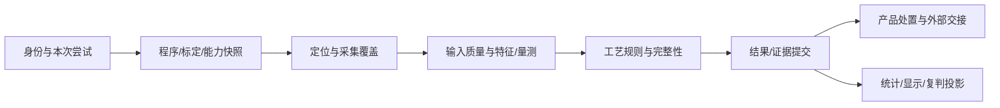

# 端到端功能链与失败恢复

- 文档 ID：`PLATFORM-FLOW-001`；版本：`0.2.1-prep`；日期：2026-09-29；状态：`DesignReview`
- 消费者：机台应用编排、模块集成、UI任务设计和系统验收。
- 模块定义见[公共模块](../shared-modules/README.md)，工艺分支见[制程目录](README.md)，字段/Owner采用[接口交接](../shared-modules/INTERFACE-MAP.md)与[GATE-001](../00-baseline/REQUIRED-REPOSITORY-AUTHORITIES.md)。下表是顺序与不变量，不替代正式状态机。

## 1. 编程、发布和换线链

| 步骤 | 操作主体/模块 | 产物与交接 | 失败和可恢复点 |
|---|---|---|---|
| 导入与对账 | 工程师；SM-014/015；制程目标生成 | 来源/单位/面别/层、元件或焊盘映射、歧义清单 | 原件保留；未映射对象定位到来源；不靠猜测补齐 |
| 基准和目标 | 工程师；SM-008/009/010/013 | Mark/坐标/ROI、目标-FOV覆盖、适用标定 | 变换缺失、超可达、范围错配在生产前暴露 |
| 配置工艺 | 制程插件；SM-011/012/019 | 明确定义的特征、测量、规则与版本；SPI找底和AOI焊点独立 | 缺参数/缺单位/不适用算法阻断冻结，不阻断保存草稿 |
| 试算与验证 | SM-018/021/027 | 试板或数据集结果、覆盖及失败案例、与原结果差异 | 工程试算独立输出，不进入生产统计；失败返回具体目标/规则 |
| 发布 | 程序Owner；SM-004/016 | 冻结程序/资产/方法引用、批准与发布回执 | 发布条件/角色由产品决定；不支持版本或缺资格不能生产 |
| 换线激活 | 机台应用 | 核对产品/工装/面别/能力/标定后，为下一批准边界绑定程序 | 在途板保持原快照；激活失败继续保留旧已知状态，不能半切换 |

SPI最低贯穿样例：外部焊盘映射→排除域/参考面→锡膏域→体积与偏移→规则→证据。AOI对照样例：PnP位号→封装库→存在/极性/引脚→炉前或炉后专用组合→证据。两者必须能复用同一公共实现而无需公共库认识锡膏阈值或焊点缺陷枚举。

## 2. 在线生产链

| 步骤 | 关键前置条件 | 唯一产物/完成判断 | 未满足时 |
|---|---|---|---|
| 身份/尝试 | 工位/面别/产品策略、可解析读码或获批替代策略 | 本次尝试与原始身份依据；SM-017 | 消歧或受控停留，不能沿用上板身份 |
| 启动快照 | 发布程序、依赖能力、标定适用性、证据空间 | 运行引用冻结；机台应用 | 缺必需能力不开始；可选能力仅按批准范围禁用 |
| 定位与采集 | 正确坐标/触发/序列、有效装夹或走带位置 | SM-007帧与SM-013实际覆盖 | Mark失败、丢帧、错epoch、不可达成为明确缺项 |
| 特征/量测 | 满足算法模态、质量和适用域 | 特征/被测量/有效性及来源 | 独立项可否继续由产品策略确定；无效不产生零值“合格” |
| 规则/聚合 | 规则版本、阈值、必须项目和实际覆盖 | 机器候选结论和不可评价项 | 缺规则/覆盖不默认通过 |
| 提交 | 身份/快照/结果/证据一致、同次提交标识 | 可查询的持久化回执 | 失败或未知先查询/恢复，不能放行未确认事实 |
| 处置/交接 | 持久事实及获批处置权限；设备互锁 | 明确业务决定、设备请求及实际确认 | ACK不是板已离开；未知动作不得盲重发 |

这里的“处置”具体Owner、规则、是否需要人工及设备互锁尚待产品批准；文档没有替用户决定放行策略。统计/显示不在生产事实提交事务里等待，AI也不插入隐含必经步骤。质量放行、软件发行、程序发布分别使用各自中文术语，避免一个Release混用。

## 3. 离线重现、改参对比与产线一致性

SM-020只读证据→SM-021校验帧/程序/算法/标定版本→SM-018相同计算节点→工程结果→差异报告。精确重现必须引用原版本；任何改参、换算法或换标定都是另一个工程试验，记录变化项。不能用当前程序重跑后宣称原机器当时就得出该结论。

离线端口不装配设备命令能力；仿真帧明确来源；回放结果不覆盖生产事实或进入默认良率。原证据缺失时写明不可重现，截图只能辅助观察。回放是问题分析/资格验证路径，不要求每块生产板在结果提交后串行再跑一遍。

## 4. 复判、返修、复测和最终处置

| 步骤 | 状态和事实边界 | 用户操作/错误处理 |
|---|---|---|
| 取任务 | 已提交结果生成的任务投影；领取租约与原事实分开 | 在线队列与离线查阅区分；双站冲突显式反馈 |
| 看证据 | 原机器测量/规则/2D/3D/整板和覆盖只读 | 默认定位当前缺陷，键盘导航带板身份；证据缺失不准静默跳过 |
| 人工意见 | 复判Owner新增意见、理由、操作者和版本 | 提交点复核租约/权限；回执未知查询，不重复意见 |
| 返修 | 记录动作和对象，不改历史测量 | 未修、已修、未复测必须可区分，具体状态词来自正式契约 |
| 复测 | 新尝试关联旧尝试与返修记录 | 使用明确程序/面别，禁止覆盖原结果 |
| 处置 | 质量Owner依据适用规则生成决定；UI只投影 | 放行/扣留等动作范围待批准；机器PASS、人工意见、复测PASS均不隐含取得最终放行权 |

不同工序的允许意见和返修表单由PG提供，SM-022只提供公共任务机制。数据汇总同时保留原检、人工意见、返修和复测维度，不能选择最好的结果消除失败历史。

## 5. 故障恢复矩阵

| 断点 | 已知/未知必须查询的事实 | 自动动作的设计边界 | 操作员可见恢复 |
|---|---|---|---|
| 采集中断/断连 | 实体位置、当前epoch、完整帧集合、设备是否确已停止 | 停止受影响任务；资源排空；重连新epoch，不能把旧回调接到新板 | 原因、缺失FOV/区段、重新定位/重拍条件 |
| 算法取消/超时 | 节点输入和已完成项、是否持有帧租约 | 纯计算按同快照可重试；有副作用步骤不一般化重试 | 不可评价项及继续/终止的批准条件 |
| 证据/结果提交中断 | 文件校验、事实提交键、回执、发件箱状态 | 查询同一键；未完成协议按持久化设计恢复，不改历史 | “未提交/已提交/状态待确认”可区分 |
| 外发上报失败 | 已提交事实、送达/消费回执 | 可重复上报需幂等；离线积压有容量与过期策略 | 数据截至位置和待交付数，不伪称MES已收 |
| 设备动作ACK丢失 | 设备实际状态、动作键/期限、互锁 | 若协议不能查询/去重，挂起待人工按设备规范恢复 | 哪一动作结果不明、确认要求，不能只有“重试” |
| 进程/断电重启 | 在途实体、运行快照、提交状态、外部动作 | 先恢复一致性再接新板；不自动发历史运动/反馈命令 | 逐项核对板位置、程序、证据与未决动作 |
| 磁盘满/存储降级 | 尚可承诺的证据容量和提交条件 | 停止接收超出承诺的新工作；不静默删证据/用户配置 | 容量影响、允许归档/恢复的责任和条件 |
| 标定失效 | 新运行/在途运行引用及失效原因 | 新任务阻断受影响物理量；在途按产品批准策略处理 | 受影响测量范围与重新标定/复测要求 |
| 升级失败 | 备份点、配置/数据版本、迁移完成度 | 按SM-028恢复一致点；不可逆迁移不只回退EXE | 明确停机和恢复进度；原配置/结果仍有恢复路径 |

安全互锁、急停、运动停机性能由设备安全体系定义，通用软件取消不代替它。没有硬件资料时只验证接口模拟状态，不宣称实际安全响应时间。

## 6. 跨工序质量链与受控反馈

按板/子板/面别/工序/尝试关系取已提交事实→按指定版本构建跨工序投影→标注迟到、缺失、重检、人工更正→产生统计/排查建议。SPI异常与AOI缺陷的空间/身份关联需要明确映射与时间窗；相关性不证明印刷导致焊接缺陷。

执行细节分为[048关联核心](../shared-modules/packages/PKG-048_ProcessCorrelation.md)与[058B质量消费](<../shared-modules/guidance/06-domains/DEV-DOM-058B_Cross-Process Correlation与Disposition闭环开发指导.md#quality-correlation-consumption>)：先固定问题/分析单位与来源截至点，再核工序前驱/返修及Pad—脚—焊点多重关系，后核量种/参考/单位/方法可比性，最后交045指定统计。外部消息总检查数不补逐目标PASS，默认值/自动Guid不自证成功或新返修。不同工序尝试不强求相同ID；缺关系不按最近时间填齐。

返修完成→新实体复检尝试/回执→目标及邻域覆盖→原质量Owner评估，不能从局部PASS或重放旧图跨越。固定分析缺源后迟到只形成后继投影；原保存Unknown查原操作。原机判、人判、返修、正式质量决定、设备接纳与实物去向分别显示，统计投影不能成为第二处置权威。原源数据/关系未变时复用查询与验证，不让各产品重复实现join或统计。

打印机反馈另走：获批分析产生候选→检查作用域/限幅/模式/权限→人工或已批准的控制策略接受→SM-024发送有身份和期限的命令→设备确认/回读→保存实际执行事实。当前仅保留该边界，未批准自动闭环；不能将SPC报警直接连到运动或调机API。

## 7. 端到端验收与后续冻结顺序

| 切片 | 独立验收断言 | 需要的前提 |
|---|---|---|
| 公共帧/ROI最小宿主 | SPI和AOI两个宿主均可投帧、改ROI、试算、关闭；无跨产品私有引用，取消无资源遗留 | 控件公共接口与平台接入方案；不包含AsunImage/DevExpress准入验证 |
| SPI离线贯穿 | 单板/拼板输入→找底/量测/规则→证据→回放可复核；无效域不伪PASS | 已批准量测定义、目标映射、输入样例和Schema |
| AOI复用验证 | 元件/引脚/焊点分工能复用公共帧/执行/证据；无SPI字段污染 | 炉前/后独立FunctionSpec和适用样本 |
| 提交与复判故障链 | 提交回执丢失、双站争用、返修重检均保留唯一事实及历史 | 正式Owner/状态/事务边界和故障注入设计 |
| 首台设备落地 | 正常/停机/重启/缺帧/交接与UI可用性、质量和吞吐按Profile通过 | 设备资料、Golden、HIL、计量及现场条件 |

这些是先后依赖，不是新增自动执行队列。当前完成文档设计和交接核对；下一阶段逐切片补齐并批准契约/状态/阈值/页面/样本，再实现。硬件门槛不阻断纯计算和离线设计，缺生产权威不靠造一套临时Schema绕过。

## 8. 新机台的共用主链与工艺分支

研究顺序已由用户确定为钻孔/微孔→阻焊与终检→钢网→点胶/涂覆→插件与焊后；这不表示首台设备投产顺序或客户交期已经确定。各PG的新增计算链是DesignReview，仍需绑定正式FunctionSpec和产品Profile。

| 工艺链 | 共享模块调用与工艺决策 | 必须截断的错误路径 |
|---|---|---|
| 钻孔/微孔 | SM-014制造元素→PG孔型/工序目标→SM-008/009独立基准→SM-011候选+SM-010几何→PG一对一关联/孔位/缺多孔→SM-019→结果Owner/SM-020 | 板定位失败不能继续全板孔位；孔底不可见不能从孔口推深度；拟合去点不删除毛刺证据 |
| 阻焊/终检 | SM-014层意图→PG材料/应覆盖/开窗/面别→SM-011区域候选→SM-010几何/SM-012适用形貌→SM-013必要功能/双面覆盖→规则与提交 | 材料分割和未测域分开；双面错板拒绝组合；终检不重做待接入蚀刻线路引擎 |
| 钢网 | SM-014/015具名参考→PG检验阶段与制造补偿→定位/区域/几何→局部形状与全局位置分离→清洁度/尺寸规则→提交 | 切割文件与PCB焊盘不能混作同一参考；拼接重叠不重复计孔；2D不补厚度 |
| 点胶/涂覆 | PG胶点/路径/应涂/禁涂目标→SM-006/007模态输入→SM-011分割→SM-010截面及SM-012参考面→PG物理量/采样定义→SM-013分功能覆盖→SM-019/020 | UV覆盖不流入膜厚判定；分支骨架不自带路径意图；未抽3D目标无高度PASS |
| 插件/焊后 | SM-014/015针型/封装→PG顶面装配或底面焊点目标→几何/高度/多视候选→PG针/焊料分区和邻接规则→完整性→规则与提交 | 针长不能量到焊料顶；遮挡不默认缺针；外观不产生孔内填充率或电接触结论 |

这些分支的公共执行、证据、复判、报表和外部交接仍沿§1–6；不为每台机台另建提交协议或返修事实库。每个制程包新增的只有工艺对象解释、目标派生、被测量/规则和页面组合。

### 8.1 两条必须贯穿的异常演练

1. **透明胶高度缺点**：采集有图但边缘无效→SM-006保留Mask→SM-012给基底/有效域→PG决定体积是否可评价→SM-019不得以零体积或平均值补齐→SM-020保存原图/缺点/原因→UI显示受影响目标→经允许重检时产生明确新输入或新尝试。每一步都能追溯同一物理胶点。
2. **双面THT错配与提交回执丢失**：正反面身份/坐标先审查→错配时保留独立证据并阻止合并→纠正关联由授权流程记录→结果提交→回执丢失只查询原提交身份→复判引用已提交事实→质量处置Owner作决定→设备交接查实际回执。不能由统计页或人工改量测来补流程。

### 8.2 指导到可编码切片的顺序

选择PG的一项可测功能→确定引用的SM能力→取得/批准输入样例、单位/坐标、参考和被测量定义→绑定既有或获批修订的Contract/Schema及Owner→细化对应FunctionSpec与PageContract→冻结失败断言/Golden和负载预算→独立模块实现与宿主集成→Replay/实机资格。公开竞品资料负责提供设计依据，不能越过这条链自动生成生产许可。

## 9. 从单项功能到整机的三遍内容走查

第一遍按工艺/算法：从PG功能卡的输入执行到分项结果，核对可观测范围、HALCON路线、物理定义、单位/坐标、参数出处与拒识；圆度/残差、覆盖/厚度、针端/锡峰等不能混名。

第二遍按集成人：在两个最小消费者中沿SM逐操作接入检查Core/控件/适配边界；对输入拒绝、迟到、取消、提交应答丢失、重启分别追踪Owner和租约。资源与事实不得因UI关闭而丢失或重复提交。

第三遍按开发者和操作员：用卡内合成说明确认预期，再走PageContract的连续任务；检查主题与精致细节、目标/证据联动、八态与恢复、三语/键盘/布局。合成示例不作为实机性能或客户资格。仍需猜测的步骤必须回原指导补齐后才进入该实施切片。

## 10. 点胶/涂覆的组合失败走查

输入身份/阶段/方法快照→通道与表面注册→分割/几何候选→截面或域有效性→工艺规则→原提交身份持久化→UI/复判投影。量测共用[IM-036 §19.4–19.5](../independent-modules/metrology/DEVELOPMENT-GUIDE.md#194-连续截面沿程轴与有限层面计算c1)，工艺走[PG-016 §12–14](processes/PG-016_dispense.md#dispense-path-semantics)和[PG-021 §12–14](processes/PG-021_coating.md#coating-domain-semantics)，不复制第二份状态/字段。

基底r7计算遇到程序r8变更，随后取消又发生提交回执丢失：在途计算保留r7和原输入→r8只影响新任务→取消等待算子排空→已提交/可能提交仍查原提交ID→不得把r7回调写入r8、提前释放native数据或再运行设备来“补保存”。已确认的部分结果与未执行任务同时保留，是否允许部分提交由原正式契约决定，本页不自行授予。

涂覆顶部UV完整而侧面缺图且厚度界面无效：每物理表面/功能独立有效域→已见侵入NG与未知并存→UI显示各分母→程序若要求侧面/厚度，完整性保持未满足→新采集有新输入/尝试和阶段时刻→SM-023仅统计投影，人工意见/处置由原Owner记录。不能为尽快完成将模态或必需任务静默删掉。

## 11. AOI副本接纳后的2D/3D至复判闭环

共同身份/程序快照→实际帧与成像质量→全局/局部定位→2D独立候选及适用3D表面→逐目标被测量/有效性→必检完整性→工艺规则候选→可靠证据/结果提交→已提交结果生成复判任务→人工意见→产品授权处置→实际交接回执。2D/3D共享身份与资源契约，不共享所有缺陷判据；3D不可用不自动用2D PASS替代。

| 交接 | 必须核对 | 故障时闭环 |
|---|---|---|
| 制造/程序→运行 | 同板型/面别、稳定目标ID、冻结程序与必检目录 | 缺目标映射不能缩小分母；保留草稿及未决 |
| 采集→算法 | 同attempt/FOV/步序/通道/实际曝光、坐标与有效域 | 缺帧/饱和与无目标不同；关联失败不搜索错误图片 |
| 重建→计量 | 表面版本/支撑/单位/参考域/不确定度适用性 | 插值仅显示，参考不可观察则相关量无效；不填零 |
| 算法→规则 | 每必检项原值、有效性、证据/方法及未完成项 | Unknown不能被OR成功项或空列表掩盖 |
| 规则→提交 | 身份/版本/完整性、全部证据可靠持久化、同提交键 | 应答丢失查原回执；不能新ID重算制造另一条事实 |
| 提交→复判 | 原机判/原证据只读；领取租约、权限和意见版本 | 双站争用/撤权拒绝提交；未知查原意见，原机判不变 |
| 复判→处置/重检 | 人工意见与放行权分开，新尝试关联旧板/返修 | 未知设备动作查状态；重检成功不抹去首次失败 |

组合反例：U1的必检3D引脚缺域，而2D存在/字符通过→保留2D有效结果和3D缺项→规则不能整板PASS→提交原证据→复判显示缺域及允许动作；若提交回执丢失，仅查询原ID，不能重新取图换一次“好结果”。该链用真实历史引用验证；模拟器可验状态，不能替代真实成像/焊料缺陷效果。

## 12. 发布切换、运行取消与提交未知的组合链

板A已绑定r1→工程师/离线站保存并验证r2→发布Owner确认依赖持久保持、原事务及回执→机台应用在批准边界请求激活→板B绑定确切r2。A的每个节点仍使用r1。r2发布响应丢失只查原操作；无法证明可解析时不能让B进入就绪，更不能从库latest零散拼依赖。

A图中定位完成、量测native仍运行→用户请求停止→执行器停止新调度并保留帧/工作区→等待超时仅报告尚未结束→native返回后旧输出按原尝试归历史并释放→原Owner决定未提交输出与已承诺提交如何处置。若A事实提交已发生但回执丢失，查询同CommitIdentity；既不删除事实，也不重检生成新事实“补救”。B的事件与资源不能被A迟到结果覆盖。

完整验收横跨035/037/038/041及原生产Owner；分开观察发布可见、当前激活、单板绑定、节点计算完成、数据质量、持久提交和资源排空。机台物理恢复和质量放行仍由产品批准协议及现场证据决定。步骤详情只在[程序包](../shared-modules/packages/PKG-035_ProgramPackage.md#program-lifecycle)与[运行指导](<../shared-modules/guidance/02-platform/DEV-PLT-011_Inspection Pipeline与Attempt开发指导.md#attempt-cancellation>)维护，不复制第二状态机。

## 13. 历史解释到变更实验、资格及复判

原提交结果→固定历史引用/当前读取保持→选择解释或合法重算切点→核参数/模型/环境→原038节点工程执行→按稳定身份/有效性/数值/工艺判定比较→固定全案例报告。缺模型不妨碍合法历史解释，缺上游输入只能在下游输入完整的切点重算，不能以派生图声称验证采集。

两条后续链各自独立：报告→055基线候选/真值研究→原批准Owner发布新版本；原事实＋报告辅助→044领取/意见→制程返修/真实新尝试→质量处置。两条均不能回写原机判，报告本身不产生质量放行或设备动作。

组合反例：候选值在容差内但跨质量阈值；两个Invalid被错误当一致；缺5个案例只报剩余95；旧模型被CPU新后端替换；取消后native仍计算；界面自动配准掩盖真实位移。应按[DEV-QLF-070](<../shared-modules/guidance/08-qualification/DEV-QLF-070_Golden Sample与Replay开发指导.md#replay-comparison>)保留真实差异/未执行及资源责任，不能以报告已生成算整链通过。

## 14. 复判部分提交、实体返修与迟到恢复

主链：已提交机判/证据→工艺选择完整Case/Item→受控领取→原证据/草稿→独立人工事务/回执→返修授权及实际动作→原运行Owner的新尝试→新结果/覆盖核验→处置输入→经原设备协议确认。任务占用、提交组结束、整板人工闭合、返修完成、复检合格与实体离站不是同一状态。

未知链：已发送请求→响应丢失→按原身份查询→历史回执或明确未执行/仍在途。Claim随后过期不否定此前合法成功；未查到不授权过期新写。停止批次先阻新项并排空或由存储Owner废止原执行代，不能清屏障后让旧worker迟到提交。未发送草稿重连后不自动发。

迟到链：板已离站→有权质量更正→追加意见/工厂跟踪→原物理历史保持。若板仍在受控缓存且需新分流，必须重新核实物身份/位置修订/处置授权，不能因远端刚按了PASS无条件移动。局部返修后复检要核受修及受影响邻域，旧PASS能否保留由工艺明确。

两站/两个宿主、出站后更正、逐项未知＋续租、缓存换槽＋旧决定、返修记录成功＋新结果缺项联合验收，详见[044](../shared-modules/packages/PKG-044_Review.md#review-submission-recovery)、[AOI返修闭环](<guidance/06-domains/DEV-DOM-057D_AOI Review Rework与Disposition开发指导.md#rework-reinspection>)、[PG-023](processes/PG-023_review-rework.md#review-process-closure)。当前未运行设备/HIL或客户资格验证。

## 15. 独立复核、仲裁更正与数据后代

原问题/证据固定→分配独立复核→按现Claim串行正式提交→原Owner选有效前序并核必审分母→有分歧则冻结仲裁输入→有权仲裁提交/原回执→人工闭合投影→原处置流程。任何阶段缺证据、缺人员或Unknown均不默认赞成；单Item闭合不代表全板闭合。

组合反例：A更正旧意见时，仲裁员仍看旧集合→仲裁提交核原头与修订失败/进入正式新处理→保留旧草稿及所有已提交记录→重新读取受权新集合。若仲裁已成功后才有新更正，则历史成功仍可查，追加新的待处理/再审关系，不回写历史、不重放设备。清缓存不能使已见答案的人重新满足独立盲审。

数据后续链：意见/仲裁精确引用→053真值候选→055/原数据Owner核方法/独立性/用途→发布明确标签版本→固定分组评估。标签纠正只产生新版本及实验/模型影响清单，旧报告保留原真值/分母；更正不自动把生产模型换掉。详情见[044](../shared-modules/packages/PKG-044_Review.md#review-rounds-arbitration)与[数据指导](../shared-modules/guidance/07-ai/DEV-AI-063_数据集、GroundTruth与统计验证开发指导.md#review-to-ground-truth)。

## 16. 原证据查看、对照与离开的完整链

原结果/回执→当前授权裁剪投影→按精确证据角色读取/保持→006解码/Tile或027表面→007映射→049同代呈现/Overlay/命中→只读原值或显式030工程量测→按用途交原Owner导出/导航→撤呈现/取消/排空/归还。工艺只定义对象/证据/量值语义，公共查看器不判焊点/孔/胶合格，不自授人判或设备命令。

组合演练：A原图读取中切B并跨DPI屏→B已呈现→A晚到释放不能覆盖；两窗口共享A→其一撤权清图/停止借用→另一仍授权者继续读→最后退出等待GPU/native真实完成。盲审只藏右侧但图片烘焙了NG标签→该影像不能作为合格盲审输入。纯2D无高度仍可看原图；A/B没共同变换可独立比较但不画假同步十字。

对照/导出固定源与用途，不因自动对齐、LUT或Z倍率更改原检测值；截图不成为完整Replay证据。详情见[公共显示指导](<../shared-modules/guidance/05-ui/DEV-UI-042_视觉/3D工作区与ROI交互开发指导.md#viewer-2d3d-comparison>)和[证据页](../shared-modules/guidance/14-page-contracts/UI-PCS-013_Evidence_Viewer.md#viewer-specific-operations)。精确合同、真实WPF/资源压力和产品任务可用性仍需分别验收。

## 17. 从装配资料到库复用和受控程序改版

CAM/BOM/PnP及装配变体→032冻结来源/约定→工艺对账稳定实例与必检全集→034身份/硬约束/精确版本及字段来源→007/020实例化→018/019覆盖候选→原038/043工程试检→036三方差异→035逐程序CAS草稿/验证/发布→应用在批准边界激活。参考库新版不直接写程序，样本试检不形成产线质量事实。

组合演练：PnP漏一DNP及一通孔项，BOM仍含位号→不推缺行即不装，保留来源差异；Panel-A/R1和Panel-B/R1分别映射→相同封装不同MPN不误合并→库父值变更而一个实例显式锁定旧值→保留锁定并列差异→同程序多目标补丁中一项非法整笔不变→另一程序保存成功但响应丢失→按原请求查回；取消未发送项，不回滚已成功草稿。已绑定的生产板保持旧库/程序闭包。

完成断言同时覆盖“必检全集不丢”“来源/人工意图不丢”“原回执不丢”。资料不完整可继续已知域工程工作，不以空未决队列或已处理100%冒充发布完整性。具体语义见[AOI生成指导](<guidance/06-domains/DEV-DOM-057A_AOI CAD PnP与Target自动生成开发指导.md#aoi-target-synthesis>)和[公共库](../shared-modules/packages/PKG-034_ReferenceLibrary.md#reference-library-propagation)。

## 18. 全义务规划到实际覆盖和中断恢复

固定产品必检/采样库存→候选视场与观察组合→独立验证覆盖/资源/路径→宿主经035原草稿/发布协议采用计划→原设备执行及实际质量→方法评价与018实际覆盖→原规则/机判及040结果提交→按原库存及水位关联对账。019不先存第二权威计划，CoverageResult不等待自己的提交回执；提交后六阶段展示不改已提交内容。计划绿色不等于实际有效，全部NG结果也可能是完整覆盖；几何完整而未完成评价仍不完整。

组合演练：两FOV各半覆盖不可拆ROI→规划Gap；另一义务需四步序列而只有三步→实际有效支持不足；八义务中七项完成且有NG→同时保留7/8与NG。重复帧不补第八项；后续一帧失效→重算该贡献且保留其它重叠支持。运行断线有未明动作→设备Owner对账/屏障→仅对未执行且不在途任务重排，当前位置/资格变化重新验证；不从历史计划读取自动发运动。

样本无效不偷换抽样分母，solver超时无解不当物理不可行，有可行解也须独立验证及显式采纳。详见[公共覆盖](../shared-modules/guidance/04-metrology/DEV-MET-034_Coverage与Sampling开发指导.md#coverage-sampling-implementation)和[公共规划](../shared-modules/packages/PKG-019_ScanPlanning.md#scan-candidates-constraints)，软件、真实采集/HIL与客户节拍分别验收。

## 19. 从实际采集到任务质量与恢复

原计划/用途绑定→012验证观察/资源并注册关联→设备Owner配置/武装/触发→按来源代接收并冻结原帧→宿主调用013逐任务质量→原方法/018覆盖→规则/040提交→只读诊断与受控后继重拍。采集结构、方法资格与资源终结分别判断；质量失败不填产品NG，NG也不触发无限重拍。

组合演练：同FOV预期E1/E2/E3、收到E1两次及E3→缺E2；E2晚到前设备重启→新代同frame counter不能填旧槽→取消但一个旧回调尚持原缓冲→不返池或发布可再次启动→旧组封口不改hash。另一个完整组中文字ROI过曝、轮廓ROI仍可用→按两个任务分别给适用性，文字义务保持缺口；后继补拍不能从不同场景挑最优相位拼组。

静态2D明确Motion不适用，非虚构反馈；roll/line-scan用真实材料/编码器范围，不把相机回调序号当卷长。基准是[012实施与挑战](../shared-modules/guidance/02-platform/DEV-PLT-015_设备、相机、光源、运动与采集开发指导.md#acquisition-sequence-implementation)、[013指标与域](../independent-modules/image-quality/DEVELOPMENT-GUIDE.md#image-quality-implementation)；具体制程的质量/重拍政策仍由PG提供。

## 20. 成像试验到程序采纳与设备恢复

固定工程目标/草稿/完整参数组→061合法空间→原宿主按历史或实采模式观察→013及下游逐方法评价→完整候选比较→冻结选择与独立保留集验证→工程建议→原035 CAS草稿→受影响方法/覆盖/审批→产品允许边界激活；工程设备恢复另由原Owner确认，不以保存成功代替。

组合演练：基线字符低质但物理合法→允许改善试验；候选A文字好而必要反光焊点饱和→不推荐；候选B完整有效但一次实采回执丢失→查原操作，不重复触发；取消后光源读回未知→保留设备未就绪而不删原图；重开时当前草稿已被人工锁定→旧建议只作比较，不能覆盖。独立保留集失败后重新调参必须标新实验，不反复试到通过并声称盲测。

AOI逐方法/相位耦合见[057A](<guidance/06-domains/DEV-DOM-057A_AOI CAD PnP与Target自动生成开发指导.md#aoi-imaging-optimization>)；钢网边缘/污染及清洁状态见[PG013](processes/PG-013_stencil.md#stencil-imaging-optimization)。两者复用[061](../shared-modules/packages/PKG-061_ImagingOptimization.md)，没有公共PASS优化器或跨工艺通用照明常数。

## 21. 多视场拼图与原FOV检测/计量闭环

原计划/实际源及角色固定→017使用007/016坐标与022匹配估计几何→独立验证/分量与缺口→虚拟目录/可选显示→工艺从原图或已资格化网格计算→018核义务支持→原规则/040事实提交→复判查看全图并回到精确原FOV。显示颜色/接缝优化不能反向改变机判或计量结果；目标重复归并由原工艺规则处理。

演练：4必需FOV缺1且两个有重叠→只生成已知部分诊断，原义务保留缺口；其中一个孔/焊点跨缝→用完整合格单源支持或明确不满足，不靠平滑补齐；原图可读但辐射估计失败→原图/合格几何仍可查，显示无缝用途失败；工程保存回执丢失→查原意图，取消中的原生资源继续保持直到排空。之后补拍新attempt不得改旧结果hash或偷换已提交来源。

公共机制见[DEV-VIS-029](../shared-modules/guidance/03-vision/DEV-VIS-029_多FOV拼接与全局坐标开发指导.md#mosaic-implementation)，钢网见[PG013](processes/PG-013_stencil.md#stencil-mosaic)，AOI见[057A](guidance/06-domains/DEV-DOM-057A_AOI CAD PnP与Target自动生成开发指导.md#aoi-mosaic)。

## 22. 全局定位、局部匹配与备用失败的闭环

已冻结工艺Mark/作用域及参考→033模型/006原图/007坐标→022有界候选/稳定一对一对应/几何及用途验证→原全局基准绑定→局部注册辅助观察→工艺原基准下测位置/方向→018必需义务与原规则/040提交。全局定位失败不能靠每元件独立贴合制造整板合格；局部方向对称不能证明Pin1；未知质量不补0。

组合走查：主Mark在完整合格搜索域未检出→批准备用→用备用真实特征到目标关系得位姿→通过独立质量/用途门才交下游；若主结果是未解歧义或预算截断，则停止受影响链，保留诊断/原义务。新采集只有原宿主另发且生成新采集身份，重搜不能冒作独立观察。定位计算成功/草稿保存Unknown/父基准变更依次发生时查原回执并标依赖Stale，不能重采、改用latest或继续采用旧结果。

钢网“全局孔位+局部形状”与AOI“板/元件位姿+偏位/极性”作为两消费者，均验证同022无UI核心/可选控件。机制见[023](../shared-modules/guidance/03-vision/DEV-VIS-023_定位、注册与Alignment开发指导.md#matching-implementation)，工艺增量分别在[PG013](processes/PG-013_stencil.md#stencil-matching)和[057A](<guidance/06-domains/DEV-DOM-057A_AOI CAD PnP与Target自动生成开发指导.md#aoi-matching>)。

## 23. 模型变更、精确程序引用与在途板

钢网/AOI模板或OCR候选训练→原生产者导出真实文件/参数→033封存完整依赖→独立验证/原用途批准→035精确整组依赖草稿/发布→新BoardRun绑定→实际装载与运行来源→原检测/覆盖/提交。词表/预处理、模型原点/特征关系与阈值均随实际用途绑定，不能只替模型文件。库名/冠军alias变化不会热换在途板，定位失败仍保留原义务分母。

组合故障：模型r2技术保存成功但程序采用Unknown→查035原回执，不重训/再导入造r3；随后r2用途被撤回→新运行与在途处置由原政策决定，历史技术可读与事实不删除。若导出缺外部权重，空环境导入必须失败，不能从开发机缓存补成PASS。离线期限未知不能默认永久准用，历史诊断可读另核权限。共用机制在[033](../shared-modules/packages/PKG-033_ModelAssets.md#model-assets-implementation)，OCR/AI/Matching仍使用各自算法指导。

## 推理缺项、取消与方法回退的跨模块闭环

按[052实施链](../shared-modules/packages/PKG-052_Inference.md#inference-execution)：工艺绑定用途/目标与必需性→006输入/033模型闭包→038预算→052预处理/组批/逐项输出→工艺规则→原040/041提交→当前权限查询/工程比较。公共包不创建第二生产写入Owner。

AOI可见焊点外观与PG-021涂覆是两实际规划消费者：同批算A/B/C、B无结果时，B显式缺项；只有关联可信才保留A/C，不能按数组位置把C给B。缺tile/低信/OOD与结构失败各有来源，已测域保留但整体完整性不伪满。辅助缺失可继续独立批准链；必需输入缺失由原工艺政策处置，未经验证的CPU/小图/减tile不作回退。

取消发生在排队可移除；native开始后保留运行租约至确认停止，不能因UI关闭/新generation返池或误取消同batch其他板。提交回应丢失查原operation，已持久成功不被迟到取消推翻；报告读取原双侧操作，不重新推理替换证据。当前权限/模型撤回与提交的原Owner边界必须在真实组合中验证，不以分别检查一次宣称原子成立。

## 数据、真值和评估闭环

研究/资格链沿Observation → Review/Arbitration → TruthCandidate → ApprovedLabelVersion → DatasetSnapshot → Evaluation → ModelQualification → 052运行，生产处置不反向写入批准真值。评估先解析物理父级/派生链和用途权限，再冻结分组、泄漏检查、匹配和区间；失败停在具体阶段并保留原因/范围。

同板多FOV、重拍、返修、无损裁切及增强共用GroupId；held-out被调参后失去最终测试资格并要求新的未曝光集合。拒识、Unknown、不可观察、Invalid、分母为零各自保留，不能填TN或正常。标签纠正产生新版本和受影响实验/模型列表，历史报告字节不改。在线漂移只有无真值观察时不能宣布召回下降或自动重训。

闭环组合反例：旧模型选择困难候选→独立审查产生新标签→新模型评估，允许版本间主动学习；不允许以自身伪标签自证。A板1/1、B板0/99时保留1/100总体对象率与两板率均值50%的不同含义；只采复判NG队列不推全产线误报。计划内盲评读回合法，依据结果调参则追加使用记录并重新安排独立验证。方法/阈值改变不复制原图，标签/划分改版保留历史报告与影响。详细实施见[063 §9–12](../shared-modules/guidance/07-ai/DEV-AI-063_数据集、GroundTruth与统计验证开发指导.md#dataset-evaluation-implementation)。
